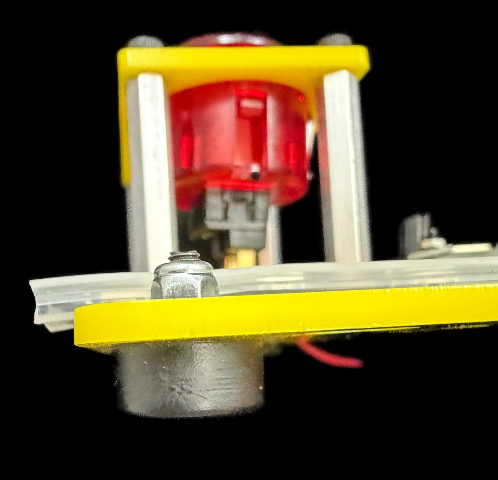
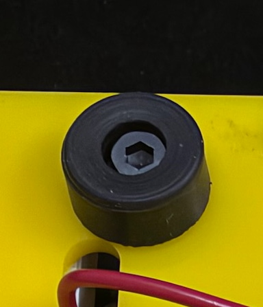
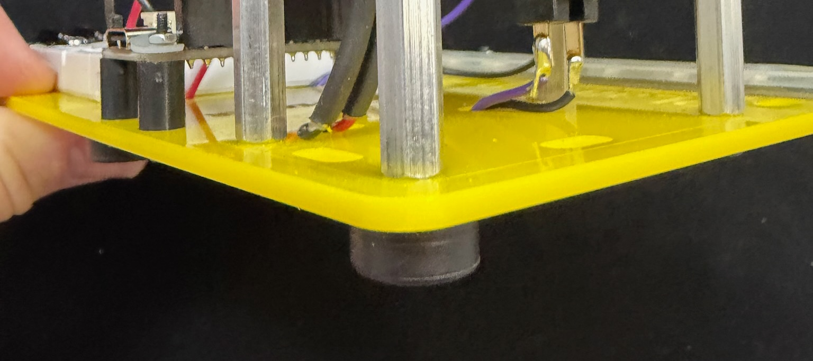
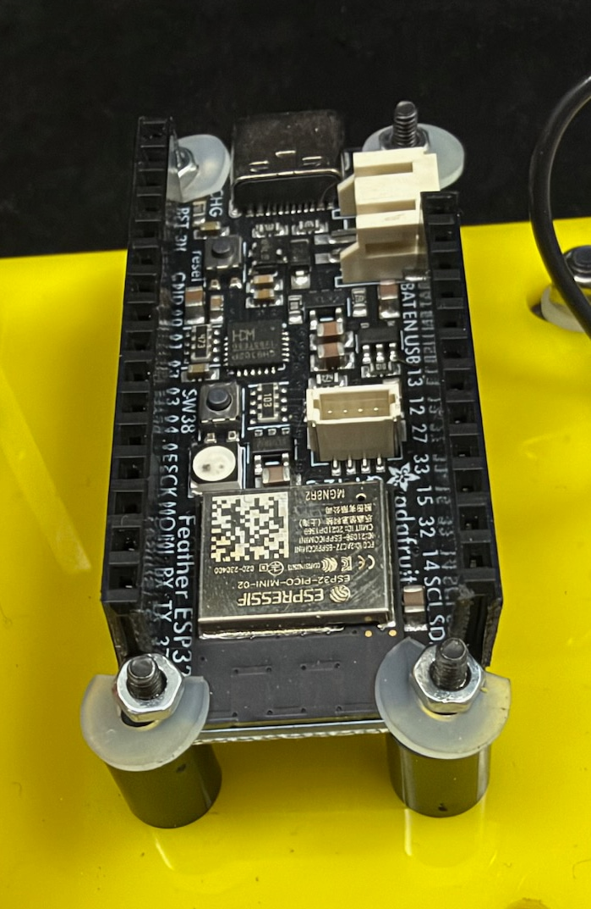
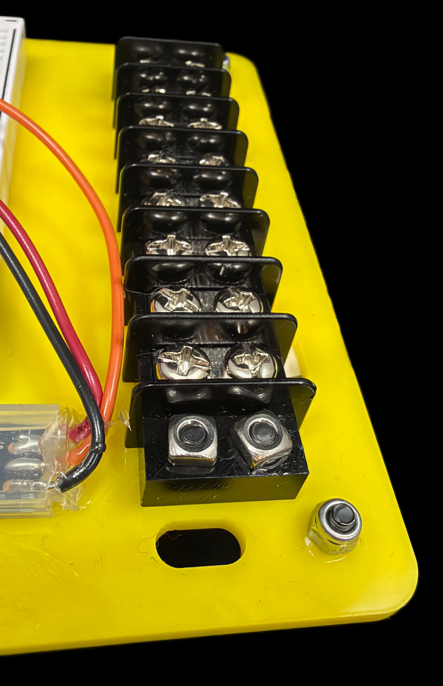
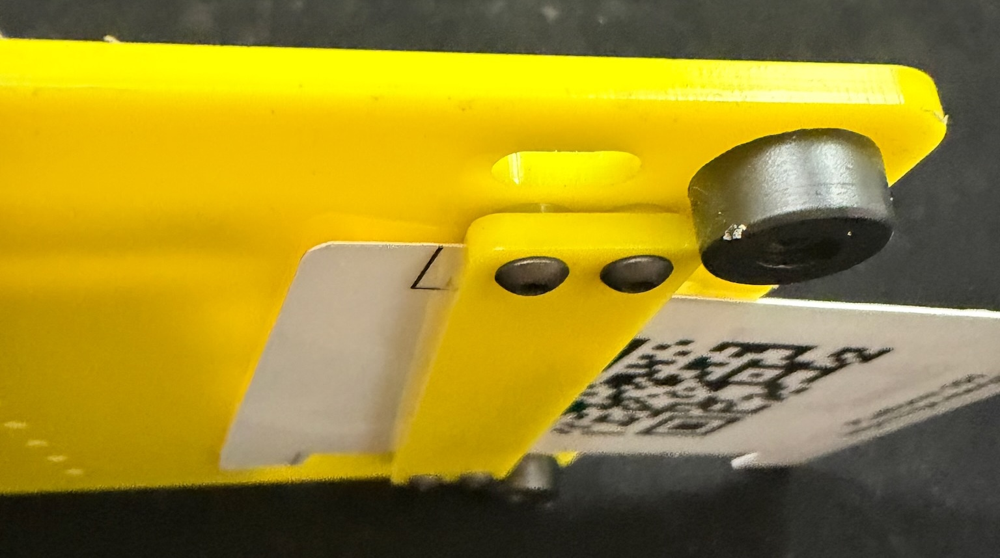
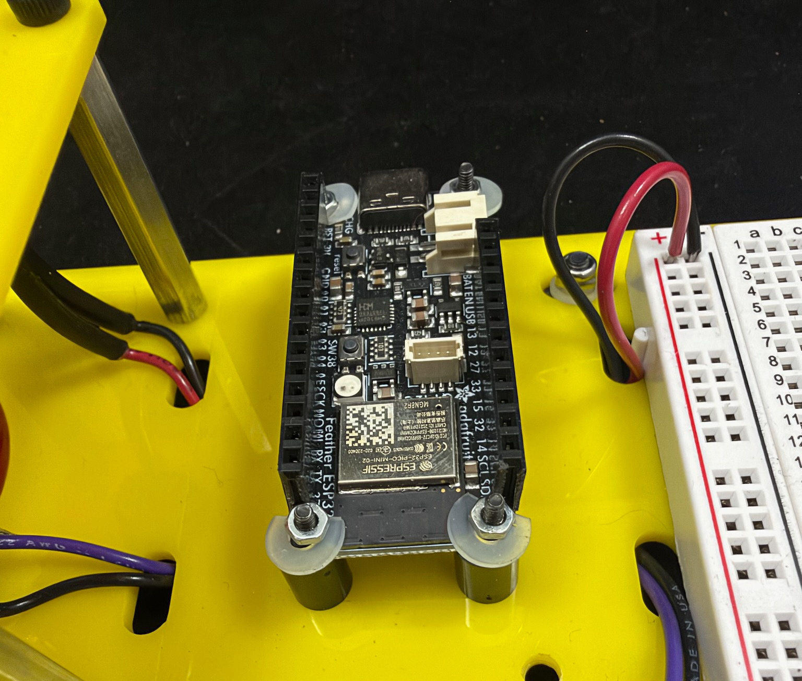
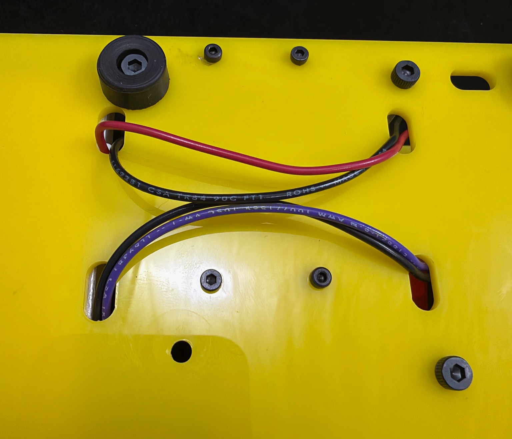
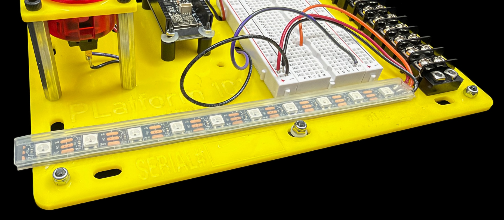

# PLatform 101 Assembly

TODO: Update the photos to show in-process assembly rather than zooming in on a fully assembled kit.

## Assembly

**Solder female headers onto Feather.** This can be made easier, with some extra-long straight headers, by using the breadboard: Put the extra long headers in the breadboard. Slot the female headers into those. Attach the Feather. Solder.

**Attach Hardware.** Attach the rubber feet, risers, daughterboard, Feather, breadboard, and terminal strip.

- For each of the five feet, **excluding the one under the daughterboard,** attach with an M3-10 screw from underneath and lock nut up top.

- The foot under the daughterboard also uses an M3-10, but screws directly into a standoff.

- Each of the standoffs takes an M3-10. Both topside (daughterboard) and underside (baseplate).
- The Feather uses M2-20 screws. It's easiest to thread those through from the front and attach M2 nuts on the back. Use a nylon washer against the top face of the Feather. Use a 10mm nylon standoff behind it so that it's not directly on the acrylic. Push the screw through the baseplate and attach it in the back with an M2 nut.

_In the above image, the screws are reversed from the text description. Follow the text and attach the nuts on the backside of the baseplate. It is FAR easier to do it this way._

- The breadboard is adhesive and can just stick on.
- The terminal strip uses M3-16 screws. The basic install is straightforward — attach from the underside. If you also want to add the quick-reference card, see below.

If you're using the **pull-out quick reference card,** that sits under the terminal strip and takes some extra work: 
- You'll also need to laser-cut the pull-out bracket.
- You'll need four nylon washers as spacers.
- You'll want to print on cardstock, laminate, and cut the pull-out quick reference card.
- Ideally, the four screws you use have low-profile heads, otherwise they may extend past the rubber feet.
- Assembly can be a little tricky. Put the four screws through the pull-out bracket. You might use some tape to temporarily hold them in place. Then put the nylon spacers on the screws. Attach this to the bottom of the PLatform, with the terminal strip up top. Finally attach a nut to each screw (carefully removing the tape one at a time, if you used tape as an aid).

**Solder Leads.** Solder leads to power, pushbutton, and LED strip.

- **Power jack:** red for positive, black for negative. Cut the leads to about 19cm, strip and tin the other end. If you want to get fancy, put some heat-shrink tubing around the terminals. Route them down through the first oval hole, behind the microcontroller and acrylic plate, up through the other oval hole next to the breadboard, and attach to the positive and negative rails of the breadboard.
- **Pushbutton:** Similar to the power jack, cut two lengths of wire to about 25cm, tin the tips, solder to the button terminals, and thread around the backside of the board to the breadboard. These wires are a little longer because I like them to reach anywhere on the breadboard. I also like to use a black wire and a wire color without a strong connotation (purple, orange, or blue) because I'll use the internal pull-up resistors in the microcontroller and route the black to ground.

- **LED Strip:** Trim the LED strip to 10 LEDs. Cut and tin wires for power (red), ground (black), and data (any non-affiliated color such as purple, orange, or blue). About 12cm seems long enough to reach anywhere on the breadboard. Attach the strip to the acrylic plate using your adhesive of choice (hot glue works great). Optionally, put a little dab of adhesive around the solder joints as a strain relief. If the LED strip has a bend to it from being wound on a reel during shipping, you may need to clamp it down until the adhesive sets.

Optionally use a rotary tool with an etching bit to etch a value into the Serial Number box on the acrylic baseplate.

## Bringup Testing

Once assembled, it's a good idea to load a small program to test out the microcontroller, the button, and the LED strip.

TODO: provide sample program
