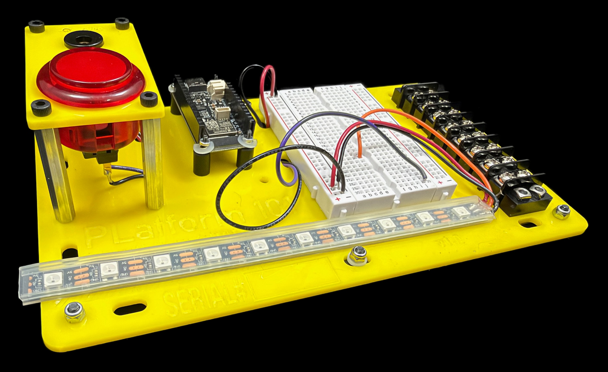
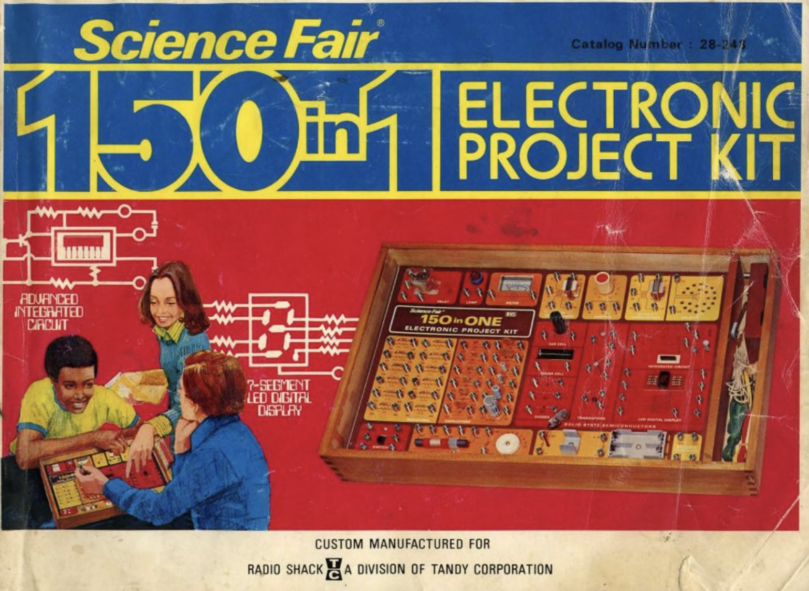
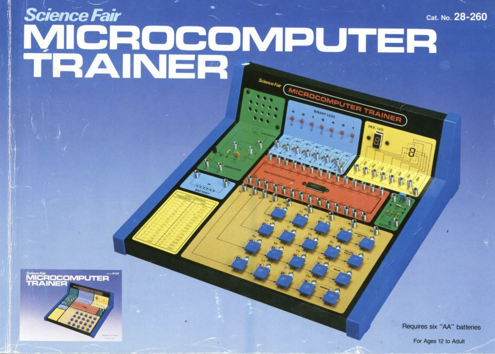
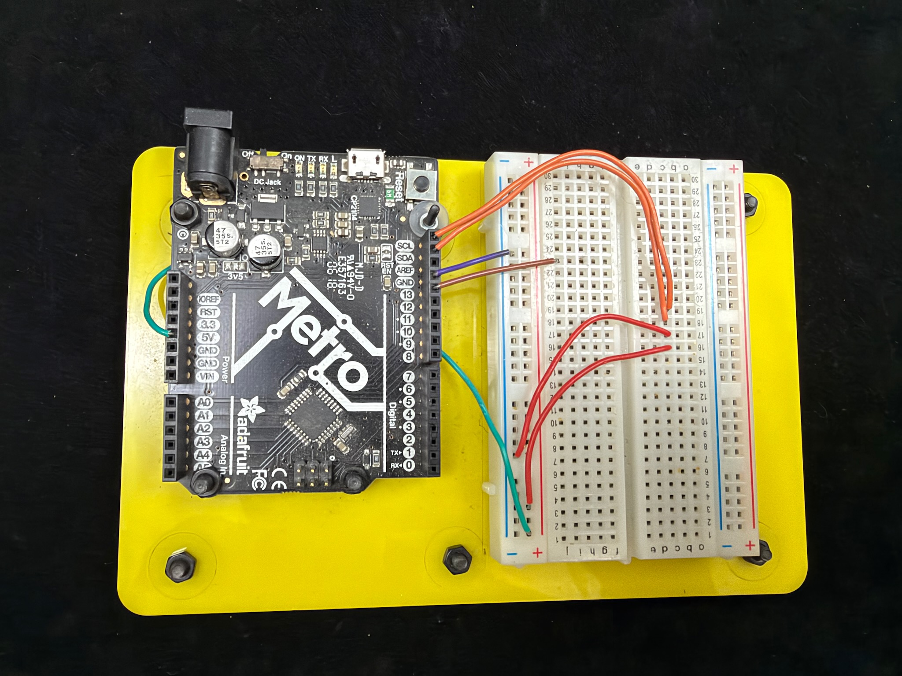

# PLatform 101

## About

[PLatform 101](https://github.com/Past-Lives-Makerspace/PLatform101) is an electronics platform for learning and prototyping with electronics and microcontrollers. Assuming you have access to a laser cutter, scrap acrylic, and commodity hardware bits (wire, solder, M3 screws and nuts), it can be built for about $35.

The kit features:

- An ESP32 variant with extras like LiPo battery charger and I2C quick-connect
- 10-LED RGB strip
- Arcade button (plus a small user button on the ESP32 itself)
- A standard 2.1mm power jack — generally not needed for small projects because the ESP32 USB can, for instance, supply enough current for the 10 LED strip.
- Solderless breadboard
- Terminal block for hooking up larger external gear, without fear of ripping wires from the breadboard
- No-skid rubber feet
- Zip-tie points for incorporating the kit into a larger project
- A pull-out quick reference card

This repository has everything you need, including the laser files, the parts inventory, assembly instructions, code and instructions for testing and bring-up of the project kit, and workshops that allow you to use PLatform 101 as a teaching/learning tool.

The uppercase first two letters is a nod to [Past Lives](https://www.pastlives.space), the makerspace I belong to. People there have been curious about things like the ESP32 microcontroller and programmable LED light strips.

The “101” is an indicator that this is the beginning. I encourage folks to mutate the design, build derivatives, and just go wild. I would personally prefer you keep the “PLatform” name, but the Creative Commons license basically says you can do what you want. I am not your mom.

## Inspiration

When I was a kid, I had the [Radio Shack Science Fair 150-in-One project kit](https://archive.org/details/science-fair-150-in-1-electronic-project-kit/mode/2up). I started by blindly following the instructions for projects but eventually learned the basics of electronics. Years later, I did the same with the [Radio Shack Microcomputer Trainer](https://archive.org/details/mct-28-260).

&nbsp;

Probably a decade ago, I made my own mini version of PLatform for prototyping. It used an Arduino-variant and found it quite useful for quickly testing ideas:

## Building

- [Bill of Materials](BOM.md) : All the parts you'll need to gather together.
- [Assembly](Assembly.md) : How to assemble PLatform 101.

## Workshops

These are in the [./Workshops/](./Workshops/) folder.

## Alternatives

About the parts selection: I selected parts that I expect to be easy to obtain for years to come. The Adafruit Feather is possibly overkill for some projects. It is a good microcontroller that has been around, in some form or another, for years. It includes quite a few nice-to-have peripherals, including built in battery charging, STEMMA I2C quick-connect, RGB LED, separate 3.3v power supply, and lots of digital+analog pins. Additionally, I'm an Adafruit stan. I have a bias toward the company, as it's an indie hardware business and feels very much like what Radio Shack would be if it had managed to survive by catering to electronics hobbyists, as opposed to veering over to low-margin consumer electronics. Everything they sell has extensive documentation and walkthroughs, complete with multiple example projects.

If the Feather microcontroller board is overkill for your application, it's worth investigating other solutions. Most such boards can be easily plugged into the breadboard. In this way, you can continue to use the platform, ignoring the Feather microcontroller. Alternatives you might consider:

- [Seeed Studio XIAO ESP32-S3](https://www.seeedstudio.com/XIAO-ESP32S3-p-5627.html) is a smaller, leaner ESP32 without all the bells and whistles of the Feather. At the time of writing, it costs only $8.
- The [Adafruit Gemma](https://www.adafruit.com/product/3501) is marketed as a wearable. It has no wireless capability, but does not include the LiPo battery charger. It includes a physical on/off switch, an RGB LED, but only three GPIOs (digital or analog, input or output)
- The [Adafruit Trinket](https://www.adafruit.com/product/1501) is similar and slightly cheaper. No wireless, no battery circuitry, but has 5 GPIOs.

There's nothing preventing you from ignoring the Adafruit ESP32 attached to the PLatform and simply using one of these alternative microcontrollers directly on the breadboard. If you need a smaller, cheaper controller — go for it!

Let's say you don't care so much about using the microcontroller to get inputs from the real world (WiFi, button presses, sensors) and don't want to write code. You just want simple LED animations, the [Pixelblaze](https://electromage.com/pixelblaze) is a great option. The Pico is only $35 and is fully controllable via web interface.

## How To Help

- Some real-world usage from someone beyond myself, and any feedback that may result in.
- We could use more workshops (and I need to flesh out the details of the placeholder workshop I have) and possible larger projects. Zip-tie it to a chassis as the brains of a robot?
- Bringup code. Standardized wiring hookup and code for testing the functionality of the button and LED strip.
- Hardware critique and possible revisions/improvements.
- The laminated pullout reference card is a little “meh” right now and falls out easily. It could use some sort of improvement.

## License

PLatform 101 is © Copyright 2026 by [Brian Enigma](https://brianenigma.com) is released under a [Creative Commons Attribution Share-Alike](https://creativecommons.org/licenses/by-sa/4.0/) license. 

This means you are free to:

- **Share:** Copy and redistribute the material in any medium or format for any purpose, even commercially.
- **Adapt:** Remix, transform, and build upon the material for any purpose, even commercially.

As long as you:

- **Attribution:** You must give appropriate credit, provide a link to the license, and indicate if changes were made. You may do so in any reasonable manner, but not in any way that suggests the licensor endorses you or your use.
- **ShareAlike:** If you remix, transform, or build upon the material, you must distribute your contributions under the same license as the original.
